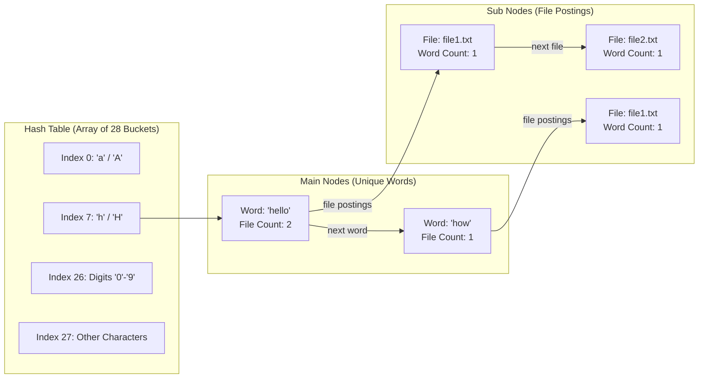

# Inverted Search Engine

An efficient, menu-driven **Inverted Index Search Engine** implemented in **C** using a **Hash Table** with separate chaining collision resolution and **Nested Singly Linked Lists**.

An inverted index is a foundational data structure widely used in document retrieval systems and modern search engines (such as Elasticsearch, Apache Lucene, and web crawlers). Instead of sequentially scanning every file for a search query, an inverted index creates a direct mapping from each unique word to the set of documents containing it along with its frequency.

---

## 📑 Table of Contents
- [Architecture & Data Structures](#-architecture--data-structures)
- [Key Features](#-key-features)
- [Project Directory Structure](#-project-directory-structure)
- [Compilation & Execution](#-compilation--execution)
- [Menu Operations & Walkthrough](#-menu-operations--walkthrough)
- [Database Persistence Format](#-database-persistence-format)
- [Design Specifications & Constraints](#-design-specifications--constraints)
- [License](#-license)

---

## 🏛 Architecture & Data Structures

The system employs a two-tiered linked structure organized under an indexed hash table:



### 1. Hash Table (`hash`)
- **Bucket Count**: 28 buckets (`HASH_SIZE = 28`).
  - `0 - 25`: Case-insensitive slots for letters `A-Z` / `a-z` (`ch - 'A'` or `ch - 'a'`).
  - `26`: Digits (`0` - `9`).
  - `27`: Special characters and symbols.

### 2. Main Node (`mainnode`)
Represents a unique indexed word in a hash slot:
- `char word[50]`: Stored word token (up to `WORD_SIZE = 50`).
- `int file_count`: Number of distinct files containing this word.
- `struct mainnode *link`: Pointer to the next word in the same hash bucket (collision chaining).
- `struct sub *sub_link`: Pointer to the head of the file postings linked list.

### 3. Sub Node (`subnode`)
Represents per-file occurrences of a word:
- `char f_name[50]`: Name of the file containing the word.
- `int word_count`: Number of times the word appears in this file.
- `struct sub *link`: Pointer to the next file posting node.

### 4. Input File List (`filename`)
A singly linked list used during validation to keep track of valid, unique input files:
- Validates file extension (must be `.txt`).
- Validates file existence and readability.
- Validates non-empty files (at least one character).
- Filters out duplicate arguments.

---

## ✨ Key Features

1. **Robust File & Argument Validation**: Validates all command-line arguments to verify file existence, valid `.txt` extensions, non-empty contents, and filters out duplicates.
2. **Inverted Index Creation**: Parses text files token by token (`%49s`), hashing and indexing words into the data structure while tracking frequencies.
3. **Database Visualization**: Displays the entire inverted index, showing bucket indices, words, file counts, and file-by-file frequencies.
4. **Fast Word Search**: Quickly looks up any queried word directly through hash index calculation and displays all files where it occurs along with word counts.
5. **Database Export & Backup**: Saves the in-memory inverted index database to a formatted `.txt` backup file (`#index;word;file_count;file1;count1;...;#`).
6. **Dynamic Database Update**: Allows adding and indexing a new file into the active database at runtime without rebuilding the existing index.
7. **Complete Memory Deallocation**: Properly traverses and frees all dynamically allocated nodes (main nodes, sub nodes, and file list nodes) upon exit to avoid memory leaks.

---

## 📂 Project Directory Structure

```text
Inverted_Search/
├── .gitignore                          # Git ignore rules for build binaries and temporary files
├── README.md                           # Comprehensive documentation and project guide
├── InvertedSearch.pdf                  # Project requirements and algorithmic design specifications
├── sample_output_inverted_index.pdf    # Visual execution walkthrough and terminal output screenshots
├── inverted_search.h                   # Header file with struct definitions, macros, and function prototypes
├── main.c                              # Program entry point and interactive menu-driven driver
├── valid.c                             # Input file verification and argument parsing logic
├── create.c                            # Hash table initialization, word indexing, and memory deallocation
├── display.c                           # Inverted index display and printing routines
├── search.c                            # Word search and query lookup handler
├── save.c                              # Database backup and disk serialization routine
├── update.c                            # Dynamic addition of new files to the database
├── file1.txt                           # Sample test file 1
├── file2.txt                           # Sample test file 2
└── file3.txt                           # Sample test file 3
```

---

## 🛠 Compilation & Execution

### Prerequisites
- Standard C compiler (`gcc`, `clang`, or MinGW)
- C99 standard or higher

### Compilation
Compile all `.c` source files with compiler warnings enabled:

```bash
gcc -Wall -Wextra *.c -o inverted_search
```

### Execution
Run the executable by passing one or more `.txt` files as command-line arguments:

```bash
./inverted_search file1.txt file2.txt
```

---

## 💻 Menu Operations & Walkthrough

When launched with valid files, the program validates the inputs and launches the menu:

```text
file1.txt is added to the file list
file2.txt is added to the file list

1. Create database
2. Display database
3. Search database
4. Save database
5. Update database
6. Exit
Enter your choice : 
```

### 1. Create Database
Select `1` to parse all validated input files and build the index:
```text
Database is created for file1.txt
Database is created for file2.txt
```

### 2. Display Database
Select `2` to view the indexed words across all hash slots:
```text
[0] [a] 1 file(s) : file : file1.txt : 1 time(s)
[7] [hello] 2 file(s) : file : file1.txt : 1 time(s) : file2.txt : 1 time(s)
[8] [inverted] 1 file(s) : file : file2.txt : 1 time(s)
[8] [is] 1 file(s) : file : file1.txt : 1 time(s)
[15] [project] 1 file(s) : file : file2.txt : 1 time(s)
[18] [search] 1 file(s) : file : file2.txt : 1 time(s)
[19] [test] 1 file(s) : file : file1.txt : 1 time(s)
[19] [this] 1 file(s) : file : file1.txt : 1 time(s)
[22] [world] 1 file(s) : file : file1.txt : 1 time(s)
```

### 3. Search Database
Select `3` and enter any word to search:
```text
Enter the word to search: hello

Word hello is found in the database
It is present in 2 files 
In file file1.txt the word is present 1 time(s)
In file file2.txt the word is present 1 time(s)
```

### 4. Save Database (Backup)
Select `4` to export the current index to a persistent backup text file:
```text
Enter the backup file name: backup.txt
Database is saved in backup.txt
```

### 5. Update Database
Select `5` to index a new file dynamically:
```text
Enter the new file name : file3.txt
file3.txt is added to the file list
Database is created for file3.txt
```

### 6. Exit
Select `6` to clean up and free all allocated memory before terminating.

---

## 💾 Database Persistence Format

When saving the database via Option 4 (`save.c`), records are serialized using a delimiter structure:

```text
#<index>;<word>;<file_count>;<filename_1>;<count_1>;<filename_2>;<count_2>;#
```

#### Example backup file output:
```text
#7;hello;2;file1.txt;1;file2.txt;1;#
#8;inverted;1;file2.txt;1;#
#18;search;1;file2.txt;1;#
```

---

## ⚙ Design Specifications & Constraints

- **Maximum Word Length (`WORD_SIZE`)**: 50 characters (including null-terminator).
- **Maximum File Name Length (`FNAME_SIZE`)**: 50 characters (including null-terminator).
- **Hash Table Size (`HASH_SIZE`)**: 28 buckets.
- **Collision Resolution**: Separate chaining using a singly linked list of `mainnode`.
- **Posting Lists**: Singly linked list of `subnode` per unique word.
- **File Validation Rules**:
  - File extension must be `.txt`.
  - File must exist on disk and be readable.
  - File must be non-empty (contain at least one character).
  - Duplicate filenames passed as arguments are ignored.

---

## 📄 License
This project is open-source and intended for educational and academic use.
